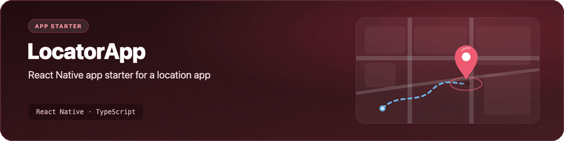

<p align="center">
  <picture>
    <source media="(prefers-reduced-motion: reduce) and (prefers-color-scheme: dark)" srcset="assets/banner-dark.svg">
    <source media="(prefers-reduced-motion: reduce)" srcset="assets/banner-light.svg">
    
  </picture>
</p>

<h1 align="center">LocatorApp</h1>

<p align="center">An early React Native starter for a location app. Today it is a single welcome screen that runs on Android and iOS.</p>

<p align="center">
  
  
  
  
  
</p>

> [!NOTE]
> This project is at the very start. It was created from the `@react-native-community/cli` template, and the only app code so far is the welcome screen in `src/App.tsx`. There is no location feature yet.

## What's inside

- 📱 **One screen:** `src/App.tsx` shows a "Welcome to My App" title and subtitle.
- 🌗 **Light and dark mode:** the background and status bar follow the system colour scheme.
- 🤖 **Android and iOS projects:** the native `android/` and `ios/` folders from the React Native 0.74 template.
- 🧪 **A smoke test:** `__tests__/App.test.tsx` renders the app with Jest.
- 🧹 **Tooling:** TypeScript, ESLint and Prettier with the React Native presets.

## Getting started

You need Node.js 18 or newer and the [React Native environment setup](https://reactnative.dev/docs/set-up-your-environment) for the platform you want (Android Studio and an emulator, or Xcode and CocoaPods on macOS).

```bash
git clone https://github.com/Worakornk/LocatorApp.git
cd LocatorApp
npm ci
```

Check and test:

```bash
npx tsc --noEmit
npm test
npm run lint
```

Run the app. Start Metro in one terminal, then build the app in another:

```bash
npm start
```

```bash
# Android (emulator running or device connected)
npm run android
```

<details>
<summary>iOS (macOS only)</summary>

Install the CocoaPods dependencies once, then run the app:

```bash
bundle install
cd ios && bundle exec pod install && cd ..
npm run ios
```

</details>

## Project structure

```text
LocatorApp/
├── src/
│   └── App.tsx            # the welcome screen
├── __tests__/
│   └── App.test.tsx       # Jest render test
├── android/               # Android project (Gradle, Kotlin)
├── ios/                   # iOS project (Xcode, CocoaPods)
├── index.js               # registers the app with AppRegistry
├── app.json
├── package.json
├── babel.config.js
├── metro.config.js
├── jest.config.js
├── tsconfig.json
├── .editorconfig
├── LICENSE
└── README.md
```

## Credits

Project scaffold from the [React Native](https://reactnative.dev) template, created with [`@react-native-community/cli`](https://github.com/react-native-community/cli). The template is MIT-licensed by Meta Platforms, Inc.

## License

[MIT](LICENSE)
